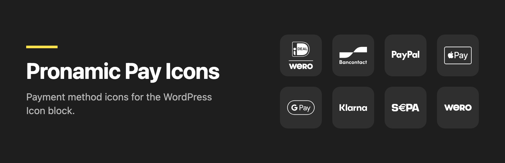
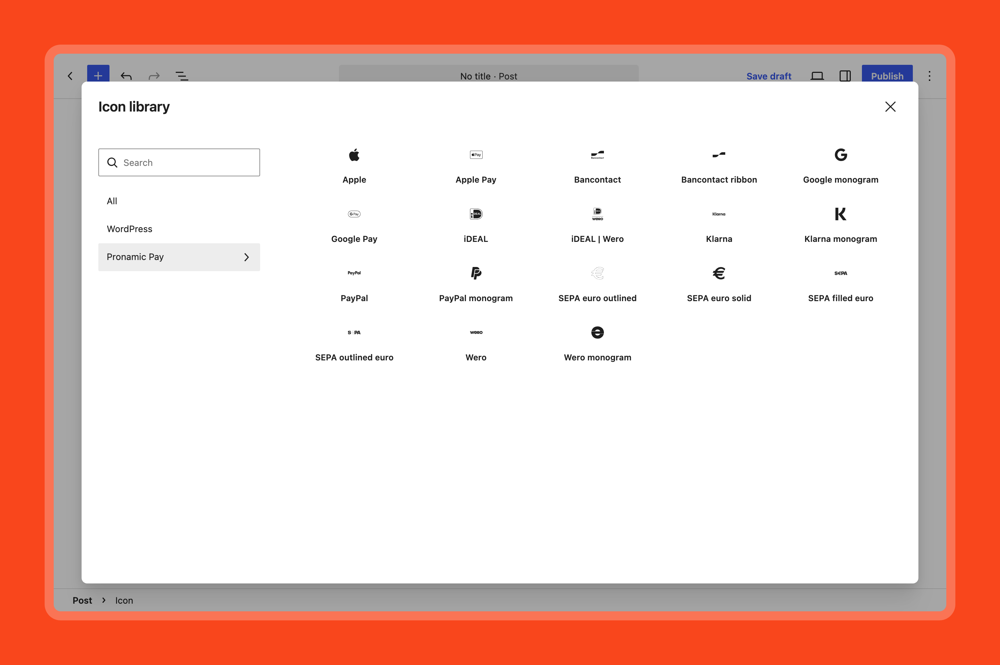
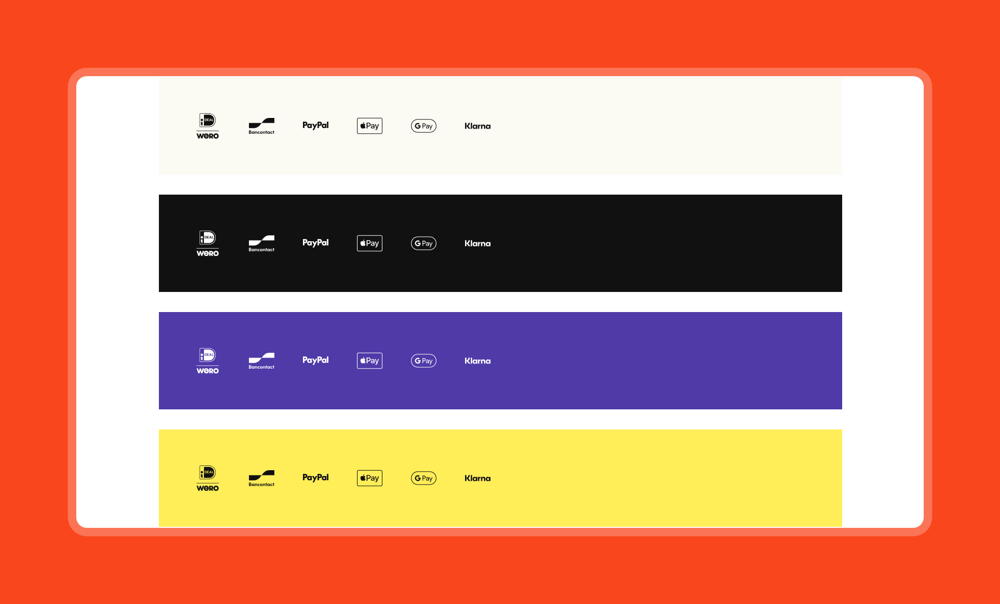
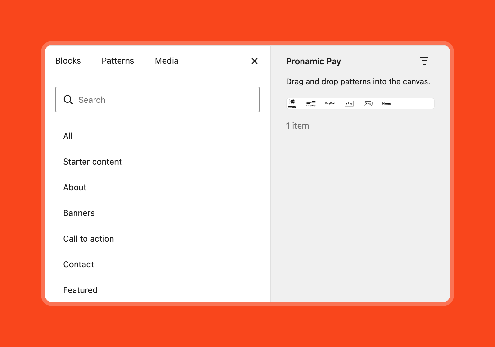
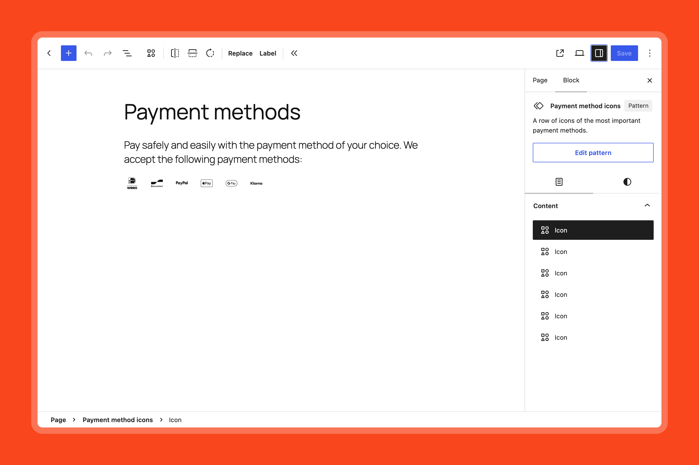
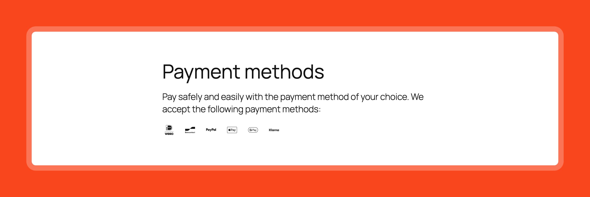

# Pronamic Pay Icons

WordPress icon collection with payment method icons by [Pronamic Pay](https://www.pronamic.eu/plugins/pronamic-pay/).

WordPress 7.1 introduced the [Icon API](https://make.wordpress.org/core/2026/07/24/registering-and-rendering-svg-icons-in-wordpress-7-1/) and the Icon block. This plugin registers a **Pronamic Pay** icon collection with single-colour icons of popular payment methods, so websites can show the accepted payment methods in for example a header or footer in a way that blends into the design.

[](https://playground.wordpress.net/?blueprint-url=https://raw.githubusercontent.com/pronamic/pronamic-pay-wp-icons/main/.wordpress-org/blueprints/blueprint.json)



## Requirements

- WordPress 7.1+
- PHP 8.2+

## Installation

### Plugin

Download the ZIP from the [releases](https://github.com/pronamic/pronamic-pay-wp-icons/releases), upload it via **Plugins → Add New → Upload Plugin** and activate **Pronamic Pay Icons**.

### Composer library

```sh
composer require pronamic/pronamic-pay-wp-icons
```

```php
\Pronamic\PronamicPayIcons\Plugin::instance();
```

The icons are registered on the `init` action. On WordPress versions without the Icon API nothing is registered.

## Usage

### Icon block

1. Insert the **Icon** block.
2. Open the icon picker and select the **Pronamic Pay** collection.
3. Optionally set a text and/or background colour, the icon follows the text colour.





### Block pattern

The **Payment method icons** pattern (category **Pronamic Pay** and **Footer**) inserts a row with the iDEAL | Wero, Bancontact, PayPal, Apple Pay, Google Pay and Klarna icons.







### PHP

```php
echo \wp_get_icon( 'pronamic-pay/ideal-wero', [ 'size' => 32, 'label' => 'iDEAL | Wero' ] );
```

## Icons

| Icon | Name | WordPress icon name |
|---|---|---|
|  | [Apple Pay](icons/apple-pay/) | `pronamic-pay/apple-pay` |
|  | [Apple](icons/apple/) | `pronamic-pay/apple` |
|  | [Bancontact ribbon](icons/bancontact-ribbon/) | `pronamic-pay/bancontact-ribbon` |
|  | [Bancontact](icons/bancontact/) | `pronamic-pay/bancontact` |
|  | [Google monogram](icons/google-monogram/) | `pronamic-pay/google-monogram` |
|  | [Google Pay](icons/google-pay/) | `pronamic-pay/google-pay` |
|  | [iDEAL | Wero](icons/ideal-wero/) | `pronamic-pay/ideal-wero` |
|  | [iDEAL](icons/ideal/) | `pronamic-pay/ideal` |
|  | [Klarna monogram](icons/klarna-monogram/) | `pronamic-pay/klarna-monogram` |
|  | [Klarna](icons/klarna/) | `pronamic-pay/klarna` |
|  | [PayPal monogram](icons/paypal-monogram/) | `pronamic-pay/paypal-monogram` |
|  | [PayPal](icons/paypal/) | `pronamic-pay/paypal` |
|  | [SEPA euro outlined](icons/sepa-euro-outline/) | `pronamic-pay/sepa-euro-outline` |
|  | [SEPA euro solid](icons/sepa-euro-solid/) | `pronamic-pay/sepa-euro-solid` |
|  | [SEPA filled euro](icons/sepa-filled-euro/) | `pronamic-pay/sepa-filled-euro` |
|  | [SEPA outlined euro](icons/sepa-outlined-euro/) | `pronamic-pay/sepa-outlined-euro` |
|  | [Wero monogram](icons/wero-monogram/) | `pronamic-pay/wero-monogram` |
|  | [Wero](icons/wero/) | `pronamic-pay/wero` |

Each icon folder contains a `README.md` with the source of the icon. See [`icons/README.md`](icons/README.md) for the icon guidelines and how to add an icon.

## Development

```sh
composer install
npm install
npx wp-env start
```

The `.wp-env.json` maps the source to `wp-content/plugins/pronamic-pay-wp-icons-dev` and the build to `wp-content/plugins/pronamic-pay-wp-icons`.

### Screenshots and wordpress.org assets

The screenshots, banner and icon in [`.wordpress-org/`](.wordpress-org/) are generated with [Playwright](https://playwright.dev/), see [`scripts/screenshots/`](scripts/screenshots/).

```sh
npx playwright install chromium
npx wp-env start
npm run screenshots
npm run screenshots:assets
```

The screenshots temporarily add a few demo pages to the `wp-env` site and remove them afterwards. The raw screenshots are saved in `build/screenshots/` and then framed on an orange background into `.wordpress-org/`. To adjust only the frame, run `npm run screenshots:frame`; no WordPress needed. The [Screenshots workflow](.github/workflows/screenshots.yml) runs the same scripts on GitHub and opens a pull request with the changed images.

### Code quality

```sh
composer run phpcs
composer run phpstan
composer run build
composer run make-pot
```

## Trademarks

All payment method names and marks are trademarks of their respective owners. The icons are simplified single-colour versions; see the `README.md` in each icon folder for the source and trademark owner.

## License

GPL-2.0-or-later
